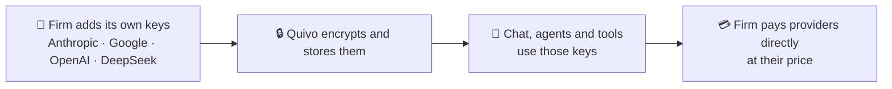
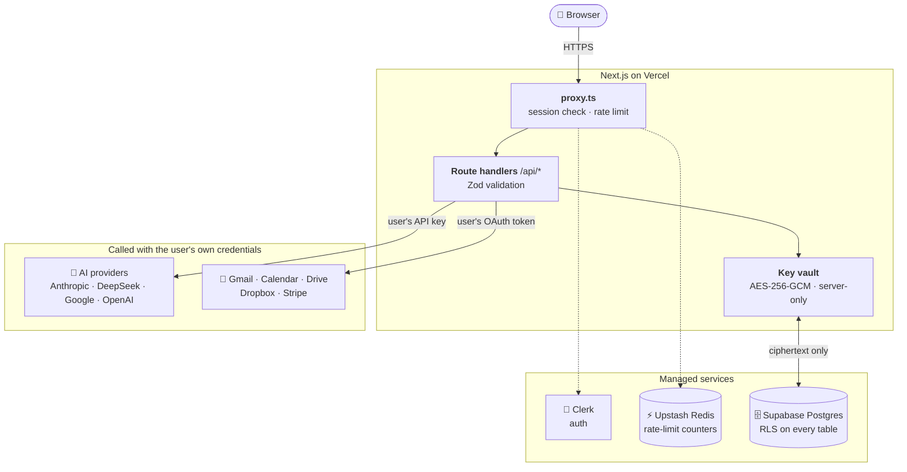
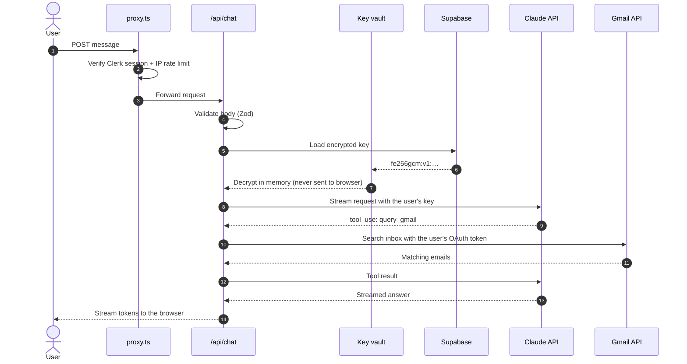
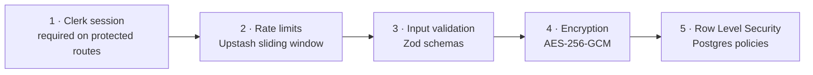

<div align="center">

# Quivo

### An AI workspace for accounting firms — bring your own API keys

Multi-model chat, 16 finance agents, a document knowledge base and connected apps in one dashboard.<br/>
Each firm plugs in its **own** AI provider keys, encrypted at rest. Quivo never pays for, or marks up, AI usage.


</div>

https://github.com/user-attachments/assets/92c372ea-5072-4240-a9d8-23abcecfddc7

> [!NOTE]
> **Portfolio project — archived.** I built Quivo in 2026 to learn how a production SaaS app is put together. Development has stopped and there is no live demo; the code is public so others can see how it works.

<div align="center">

| 🤖 **16** | 🔑 **17** | 🛣️ **31** | 🗄️ **13** | 📝 **~21k** |
| :---: | :---: | :---: | :---: | :---: |
| finance agents | supported providers | API routes | SQL migrations | lines of TypeScript |

</div>

---

## The idea

Accounting firms want AI, but most tools either **resell model usage at a markup** or **don't understand accounting work**. Quivo takes a different approach:



I work in accounting, at a firm that handles US tax compliance for foreign entrepreneurs, so the agents and workflows come from problems I see every day. I am not a software engineer by training: I built Quivo by directing AI coding tools (mainly Cursor), which meant learning to read, question and debug every change — especially around authentication and security.

## Features

| | Feature | What it does |
| :---: | --- | --- |
| 💬 | **Multi-model chat** | Streaming chat with model switching. Claude (with tool calling) and DeepSeek are wired end-to-end; Gemini, OpenAI and xAI keys can be stored and verified. |
| 🧾 | **16 finance agents** | Tax Advisor, Bookkeeper, Virtual CFO, Audit Assistant, Payroll, IRS Notice Handler, Due Diligence, Entity & Corp Law and more — each with its own system prompt. Users can also create custom agents. |
| 🛠️ | **Tool use** | In chat, Claude can query the user's Gmail, Calendar, Stripe, notes and the web — only for integrations the user has connected. |
| 📚 | **Knowledge Base** | Upload text documents or PDFs. Relevant excerpts are found by keyword match and injected into the prompt — a lightweight retrieval-augmented generation, without a vector database. |
| 🏦 | **Bank statement processor** | Reads a statement with Claude vision, categorizes transactions and exports a 4-sheet Excel workbook. |
| 🔌 | **Connected apps** | OAuth for Gmail, Google Calendar, Google Drive and Dropbox; Stripe through the user's own key. |
| ✅ | **Tasks & Notes** | Unified planner with timed reminders. |
| 📈 | **Finance view** | Live index ticker; headlines and watchlist use demo data. |

## Screenshots

| AI Chat | AI Agents |
| :---: | :---: |
|  |  |
| **API Keys (BYOK)** | **Knowledge Base** |
|  |  |
| **Finance** | **Dashboard** |
|  |  |

## Tech stack

<p align="center">
  
</p>

| Layer | Tools |
| --- | --- |
| **Framework** | Next.js 16 (App Router, Route Handlers) · React 19 · TypeScript |
| **UI** | Tailwind CSS 4 · shadcn/ui · Radix · Framer Motion · Recharts |
| **Auth** | Clerk |
| **Database** | Supabase (Postgres) with Row Level Security |
| **Security** | AES-256-GCM (`@noble/ciphers`) · Upstash rate limiting · Zod validation · CSP |
| **AI** | Anthropic SDK · Vercel AI SDK · DeepSeek API · Google Generative AI |
| **Integrations** | Gmail · Calendar · Drive · Dropbox · Stripe · Tavily |
| **Hosting** | Vercel |

## Architecture



### What happens when a user sends a chat message



## Security design

Quivo stores **other people's API keys and OAuth tokens**, so security got the most attention. It uses several layers, so one mistake doesn't expose secrets on its own:



### 1 · Encryption at rest (AES-256-GCM)

Every secret is encrypted on the server **before** it touches the database ([`lib/encryption.ts`](lib/encryption.ts)):

```ts
export function encrypt(text: string): string {
  const key = keyBytes();                       // 32-byte key from ENCRYPTION_KEY, never from the DB
  const nonce = randomBytes(12);                // fresh random nonce for every write
  const cipher = gcm(key, nonce);
  const enc = cipher.encrypt(new TextEncoder().encode(text)); // ciphertext + 16-byte auth tag
  const combined = new Uint8Array(12 + enc.length);
  combined.set(nonce);
  combined.set(enc, 12);
  return `fe256gcm:v1:${Buffer.from(combined).toString('base64')}`;
}
```

| Design choice | Why it matters |
| --- | --- |
| Key lives in an environment variable | A database leak alone reveals only ciphertext. |
| Random 12-byte nonce per encryption | The same API key never produces the same stored value twice. |
| GCM authentication tag | Tampered data fails to decrypt instead of returning garbage. |
| Version prefix `fe256gcm:v1:` | The algorithm can be rotated later; an older CBC format is still readable for migration. |

### 2 · Row Level Security (Postgres)

RLS is enabled on every table that holds user data ([`supabase/migrations`](supabase/migrations)). A user can only read their own keys (simplified):

```sql
CREATE POLICY "api_keys_owner_select" ON public.api_keys
  FOR SELECT TO authenticated
  USING (user_id = (auth.jwt() ->> 'sub'));   -- Clerk user ID from the JWT
```

OAuth token tables (`google_tokens`, `dropbox_tokens`) go further: **only the server's service role** can touch them, so even a misconfigured browser client cannot read them.

> [!IMPORTANT]
> **Lesson learned:** with Clerk, `user_id` is a text Clerk ID, not Supabase's `auth.uid()`. A policy written with `auth.uid()` *looks* secure but matches no rows. The migrations document why each policy is written the way it is.

### 3 · Other safeguards

| Safeguard | Detail |
| --- | --- |
| Rate limiting | Sliding windows per user or IP, e.g. 20 chat requests/min, 5 auth attempts/min, 50 key changes/hour. |
| Server-only secrets | The Supabase service-role client imports `server-only`, so the build fails if it ever reaches browser code. |
| Env validation | Zod checks environment variables at startup; production builds fail without an encryption key. |
| OAuth CSRF protection | HMAC-signed `state` parameter on the Google and Dropbox connect flows. |
| Key hints | The UI shows `sk-ant-…a8Kz`, never the full key. |
| Content-Security-Policy | CSP headers in `next.config.ts`, allowing only the app's own origins plus Clerk. |

## What I learned

- **Reading code I didn't write.** Working with AI tools meant understanding each change before accepting it — especially in auth and encryption code.
- **Test that security works, not just that it exists.** The `auth.uid()` vs. Clerk ID mismatch showed me a policy can exist and still protect nothing.
- **Scope is a skill.** Quivo grew from a simple chat into a full workspace. Knowing when to stop adding features matters as much as building them.

<details>
<summary><b>📁 Project structure</b></summary>

```
app/
  api/            31 route handlers (chat, agent, keys, google, dropbox, stripe, kb…)
  dashboard/      main workspace
  settings/       account, appearance, API keys
components/       43 UI panels (chat, agents, knowledge base, planner, finance…)
lib/              encryption, key vault, Supabase clients, rate limits, env schema
supabase/
  migrations/     schema + RLS policies
proxy.ts          auth, CSP and rate limiting for every request
```

</details>

<details>
<summary><b>💻 Running it locally</b></summary>

The project is archived, but it still runs with your own services:

```bash
git clone https://github.com/sowaxer/quivo-app.git
cd quivo-app
npm install
cp .env.example .env.local   # fill in Clerk, Supabase, Upstash and ENCRYPTION_KEY
npm run dev
```

Run the SQL files in `supabase/migrations/` (starting with `00_SETUP_ALL.sql`) in your Supabase project, then add your own AI provider key under **Settings → API Keys**.

</details>

---

<div align="center">
<sub>© 2026 sowaxer · All rights reserved · Shared for portfolio purposes only, not licensed for reuse</sub>
</div>
