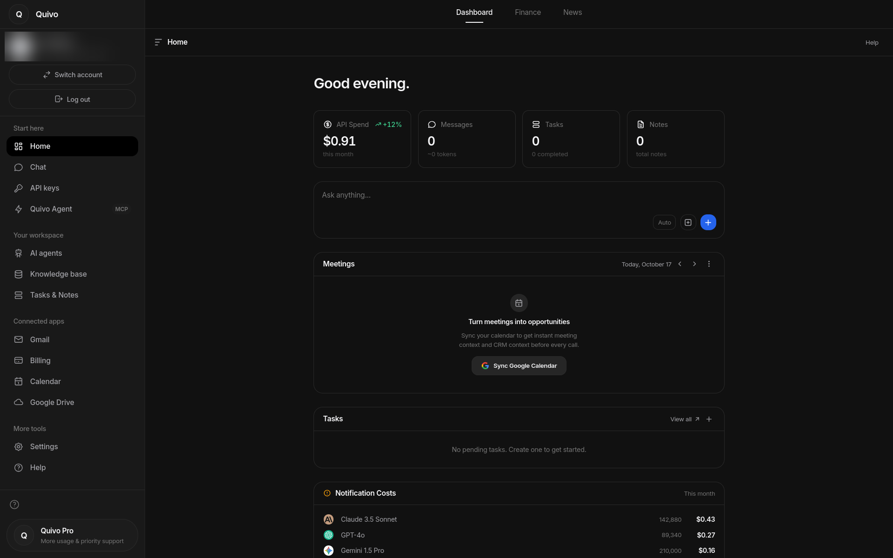
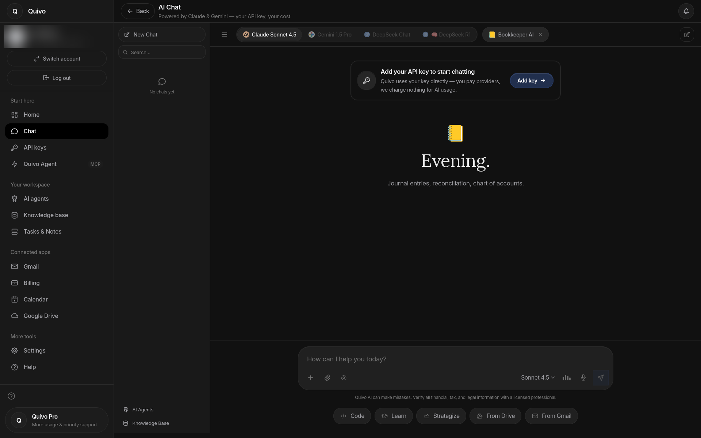
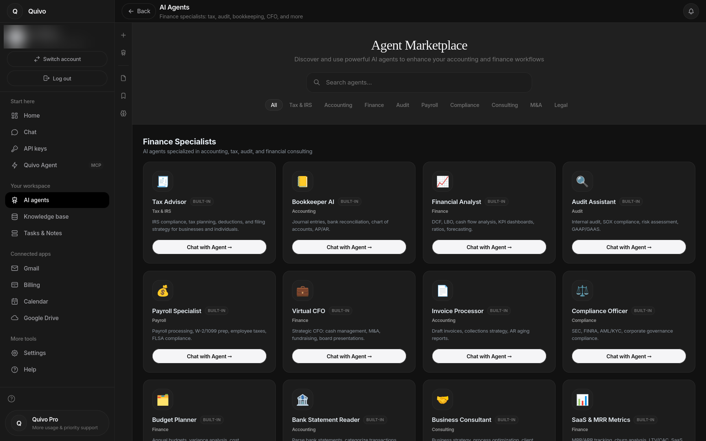
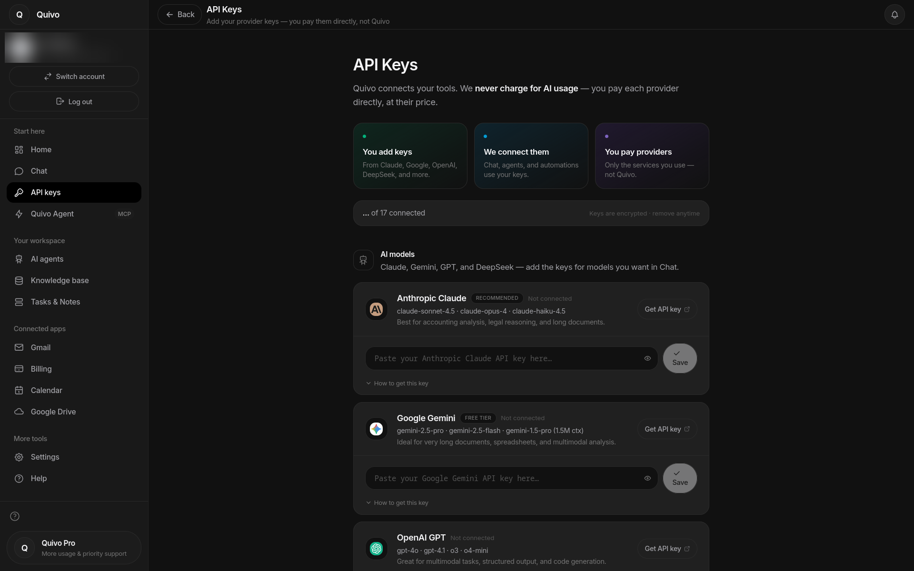
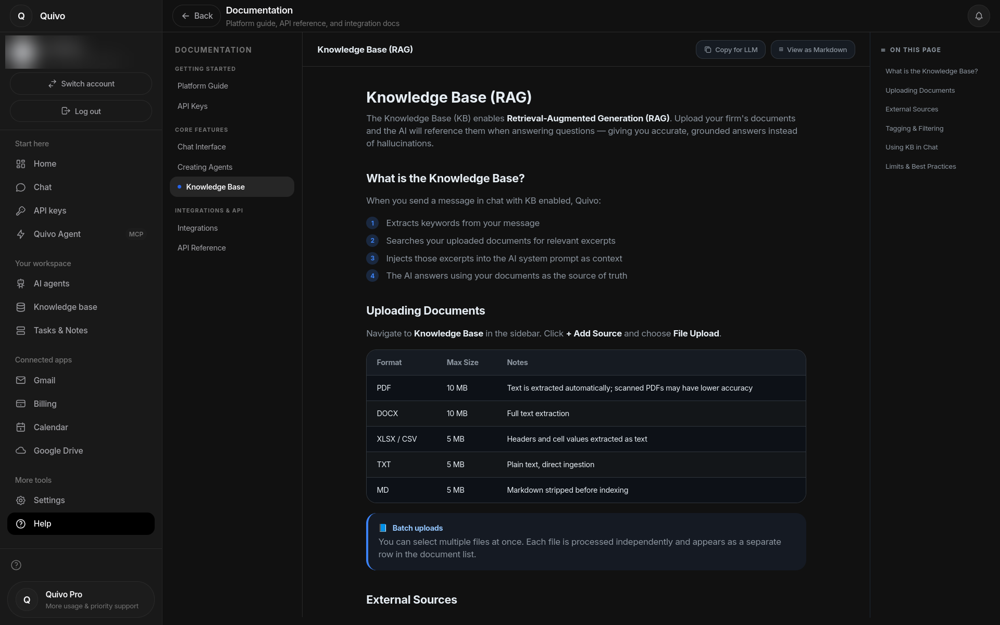
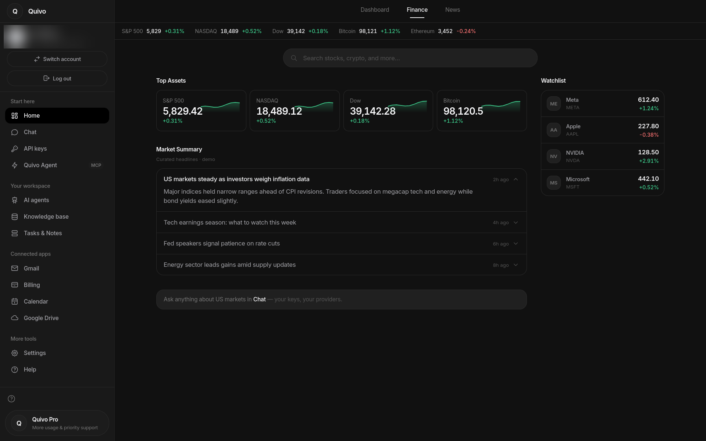
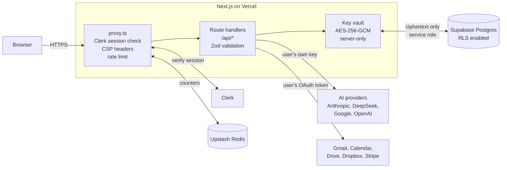

<div align="center">

# Quivo

**An AI workspace for accounting firms — bring your own API keys.**

Multi-model chat, 16 built-in finance agents, a document knowledge base and connected apps (Gmail, Calendar, Drive, Stripe) in one dashboard. Users plug in their own provider keys, which are encrypted at rest — Quivo never pays for, or marks up, AI usage.




</div>

> **Portfolio project — no longer maintained.** Quivo was a personal project I built in 2026 to learn how a real SaaS app is put together. Development has stopped and there is no live demo; the code is published here so others can see how it works.

---

## Why I built it

I work in accounting, at a firm that handles US tax compliance for foreign entrepreneurs. Every AI tool I tried either charged a markup on top of model costs, or didn't understand accounting work. Quivo was my answer: one workspace where a firm brings its **own** keys from Anthropic, Google, OpenAI or DeepSeek, pays providers directly, and gets agents tuned for tax, bookkeeping and audit tasks.

I am not a software engineer by training. I built Quivo by directing AI coding tools (mainly Cursor), which meant learning to read, question and debug the code they produced — especially around authentication and security.

## Features

| Area | What it does |
| --- | --- |
| **AI Chat** | Streaming chat with model switching. Claude (with tool calling) and DeepSeek are wired end-to-end; Gemini, OpenAI and xAI keys can be stored and verified. |
| **16 finance agents** | Built-in specialists — Tax Advisor, Bookkeeper, Virtual CFO, Audit Assistant, Payroll, IRS Notice Handler, Due Diligence, Entity & Corp Law and more — each with its own system prompt. Users can also create custom agents. |
| **Tool use** | In chat, Claude can query the user's Gmail, Google Calendar, Stripe, notes and the web (Tavily), only when that integration is connected. |
| **Knowledge Base** | Upload text documents (TXT, MD, CSV) or PDFs (basic text extraction). Relevant excerpts are retrieved by keyword match and injected into the prompt as context — a lightweight form of retrieval-augmented generation, without a vector database. |
| **Bank statement processor** | Reads a bank statement with Claude vision, categorizes the transactions and exports a 4-sheet Excel workbook. |
| **Connected apps** | OAuth connections to Gmail, Google Calendar, Google Drive and Dropbox; Stripe via the user's own key. |
| **Tasks & Notes** | Unified planner with timed reminders and notifications. |
| **Finance / News** | Market overview with a live index ticker; headlines and watchlist use demo data. |
| **API key vault** | One screen to add, test and remove keys for 17 providers. Keys are encrypted before they reach the database. |

## Screenshots

| AI Chat | AI Agents |
| --- | --- |
|  |  |
| **API Keys (BYOK)** | **Knowledge Base** |
|  |  |
| **Finance** | **Dashboard** |
|  |  |

## Tech stack

| Layer | Tools |
| --- | --- |
| Framework | Next.js 16 (App Router, Route Handlers), React 19, TypeScript |
| UI | Tailwind CSS 4, shadcn/ui, Radix, Framer Motion, Recharts |
| Auth | Clerk |
| Database | Supabase (Postgres) with Row Level Security |
| Encryption | AES-256-GCM via `@noble/ciphers` |
| Rate limiting | Upstash Redis + `@upstash/ratelimit` |
| AI | Anthropic SDK, Vercel AI SDK, DeepSeek API, Google Generative AI |
| Integrations | Google APIs (Gmail, Calendar, Drive), Dropbox, Stripe, Tavily |
| Validation | Zod (request bodies and environment variables) |
| Hosting | Vercel |

## Architecture



**How a chat request flows**

1. `proxy.ts` (Next.js 16's replacement for middleware) checks the Clerk session, applies Content-Security-Policy headers and enforces a per-user rate limit in Upstash Redis.
2. The route handler validates the body with Zod and loads the user's encrypted provider key from Supabase.
3. The key is decrypted **in memory on the server only**, used for the provider call, and never returned to the browser.
4. The response streams back to the client. If Claude calls a tool (Gmail, Stripe…), the server runs it with the user's own OAuth token and feeds the result back to the model.

## Security design

Quivo stores other people's API keys and OAuth tokens, so security was the part I spent the most time on.

**Encryption at rest — AES-256-GCM.** Every secret is encrypted on the server before it is written to the database ([`lib/encryption.ts`](lib/encryption.ts)):

- 256-bit key loaded from an environment variable, never from the database.
- A fresh random 12-byte nonce for every encryption, so the same key never produces the same ciphertext twice.
- GCM's authentication tag means a tampered ciphertext fails to decrypt instead of returning garbage.
- A version prefix (`fe256gcm:v1:`) allows the algorithm to be rotated later. An older CBC format is still readable for migration.

**Row Level Security in Postgres.** RLS is enabled on every table that holds user data ([`supabase/migrations`](supabase/migrations)):

- `api_keys` — owner-only policies that compare the row's `user_id` to the `sub` claim of the Clerk JWT.
- `google_tokens`, `dropbox_tokens` — `service_role` only, so even a misconfigured browser client cannot read OAuth tokens through the public API.

One thing I learned the hard way: with Clerk, `user_id` is a text Clerk ID, not Supabase's `auth.uid()`. Policies written with `auth.uid()` *look* secure but match nothing, so the migrations document why each policy is written the way it is.

**Other safeguards**

- Supabase service-role client is imported with `server-only`, so the build fails if it ever ends up in browser code.
- Environment variables are validated with Zod at startup; production builds fail without an encryption key.
- Per-user rate limits on chat, key writes and search.
- Signed OAuth `state` parameter to prevent CSRF on the Google and Dropbox connect flows.
- Key hints (`sk-…a1b2`) are shown in the UI instead of the full key.

## Project structure

```
app/
  api/            31 route handlers (chat, agent, keys, google, dropbox, stripe, kb…)
  dashboard/      main workspace
  settings/       account, appearance, API keys
components/       UI panels (chat, agents, knowledge base, planner, finance…)
lib/              encryption, key vault, Supabase clients, rate limits, env schema
supabase/
  migrations/     schema + RLS policies
proxy.ts          auth, CSP and rate limiting for every request
```

## Running it locally

The project is archived, but it still runs if you supply your own services:

```bash
git clone https://github.com/sowaxer/quivo-app.git
cd quivo-app
npm install
cp .env.example .env.local   # fill in Clerk, Supabase, Upstash and ENCRYPTION_KEY
npm run dev
```

Run the SQL files in `supabase/migrations/` (starting with `00_SETUP_ALL.sql`) in your Supabase project, then add your own AI provider key from **Settings → API Keys**.

## What I learned

- **Reading code I didn't write.** Working with AI tools meant I had to understand every change before accepting it, especially in auth and encryption code.
- **Security has to be designed in from the start.** The `auth.uid()` vs. Clerk ID mismatch taught me to test that a policy actually blocks access, not just that it exists.
- **Scope.** Quivo grew from a simple chat into a full workspace. Knowing when to stop adding features is a skill too.

---

<sub>© 2026 sowaxer. All rights reserved. Shared for portfolio purposes only; not licensed for reuse.</sub>
