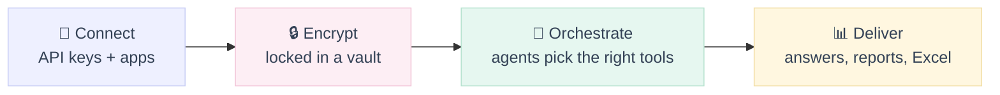
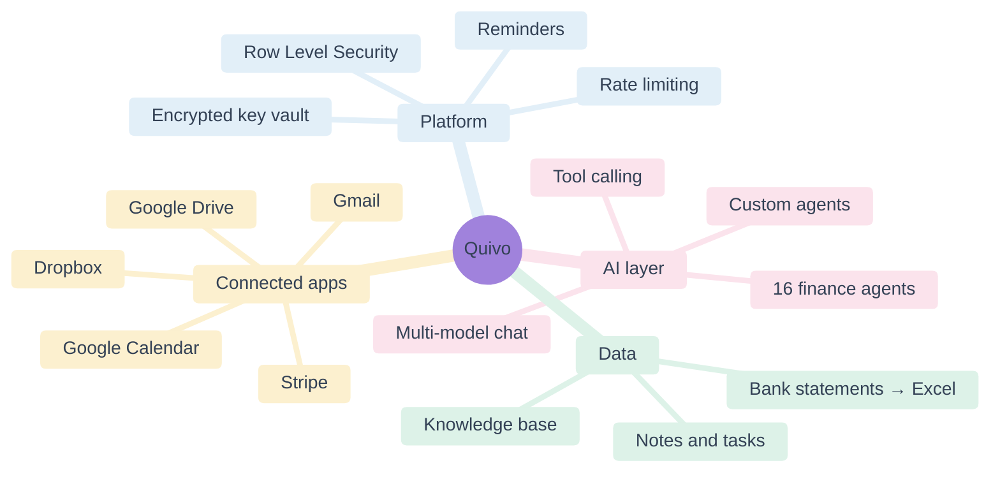
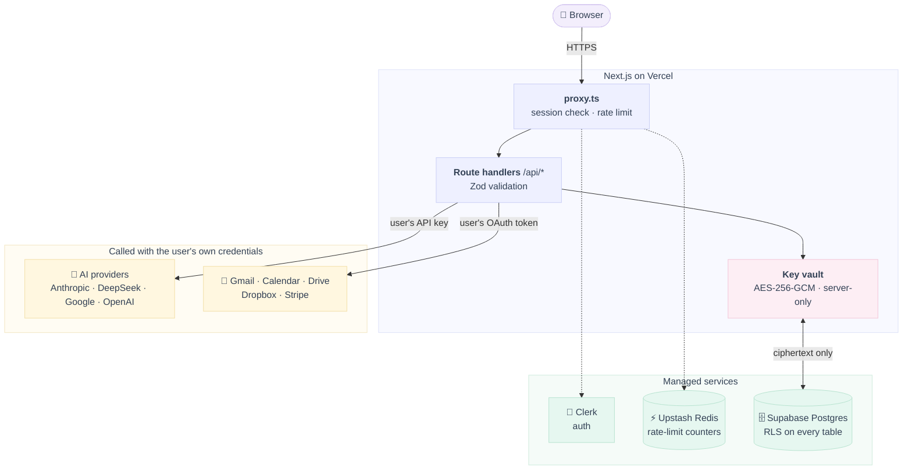
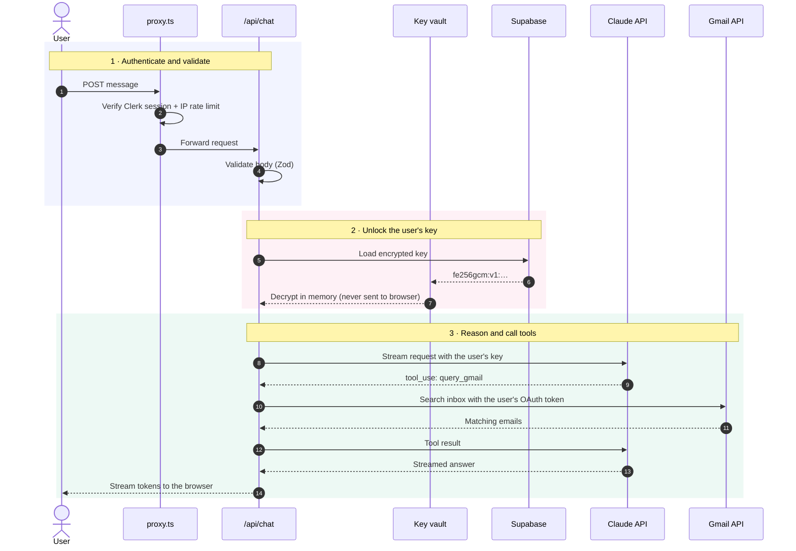
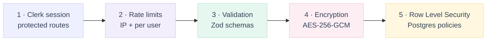

<div align="center">

# Quivo

### One AI workspace for accounting firms — using their own AI accounts


[What it is](#what-is-quivo) · [Features](#features) · [Screenshots](#screenshots) · [How it works](#how-it-works) · [Architecture](#architecture) · [Security](#security-design) · [Code](#code-highlights)

</div>

https://github.com/user-attachments/assets/92c372ea-5072-4240-a9d8-23abcecfddc7

## What is Quivo?

**Quivo puts everything an accountant uses AI for in one place.** You connect your own AI account (like Claude or ChatGPT) and your work apps (Gmail, Google Calendar, Google Drive, Stripe). Then you can ask questions, read bank statements, or get help from expert assistants for tax, bookkeeping or audit work — all from a single dashboard.

Because Quivo uses **your own AI keys**, you pay the AI company directly at their normal price. Quivo never adds a markup, and every key is locked with strong encryption.

> [!NOTE]
> **Status: archived.** This repository is published as a portfolio reference. Development has concluded and there is no public deployment.

<div align="center">

| 🤖 **16** | 🔑 **17** | 🛣️ **31** | 🗄️ **13** | 📝 **~21k** |
| :---: | :---: | :---: | :---: | :---: |
| finance agents | supported providers | API routes | SQL migrations | lines of TypeScript |

</div>

## Features

| | Feature | In simple terms |
| :---: | --- | --- |
| 💬 | **Multi-model chat** | Talk to Claude or DeepSeek and switch models any time. Keys for Gemini, OpenAI and xAI can be stored and verified too. |
| 🧾 | **16 finance agents** | Ready-made experts: Tax Advisor, Bookkeeper, Virtual CFO, Audit Assistant, Payroll, IRS Notice Handler, Due Diligence and more. You can also build your own. |
| 🛠️ | **Real-time tool calling** | While answering, the AI can look up your emails, calendar, Stripe payments, notes or the live web — only for apps you connected. |
| 🔌 | **Unified dashboard** | See your inbox, Drive files, calendar and Stripe billing in one place. |
| 🏦 | **Bank statement analysis** | Upload a statement (PDF or image); the AI reads it, sorts every transaction and builds an Excel file with 4 sheets. |
| 📚 | **Knowledge base** | Add your firm's documents so the AI answers using them, found by keyword search. |
| ⏰ | **Tasks, notes & reminders** | A planner with scheduled reminders and in-app notifications. |
| 📈 | **Market module** | Live index ticker from Yahoo Finance; headlines and watchlist use demo data. |

## Screenshots

| AI Chat | AI Agents |
| :---: | :---: |
|  |  |
| **API Keys (BYOK)** | **Knowledge Base** |
|  |  |
| **Finance** | **Dashboard** |
|  |  |

---

## How it works





## Tech stack

<p align="center">
  
</p>

| Layer | Tools |
| --- | --- |
| **Framework** | Next.js 16 (App Router, Route Handlers) · React 19 · TypeScript |
| **UI** | Tailwind CSS 4 · shadcn/ui · Radix · Framer Motion · Recharts |
| **Auth** | Clerk |
| **Database** | Supabase (Postgres) with Row Level Security |
| **Security** | AES-256-GCM (`@noble/ciphers`) · Upstash rate limiting · Zod validation · CSP |
| **AI** | Anthropic SDK · Vercel AI SDK · DeepSeek API · Google Generative AI |
| **Integrations** | Gmail · Calendar · Drive · Dropbox · Stripe · Tavily |
| **Hosting** | Vercel |

## Architecture



### What happens when a user sends a chat message



## Security design

Quivo stores **other people's API keys and OAuth tokens**, so it is built in layers — one mistake alone never exposes a secret:



### Encryption at rest — AES-256-GCM

Every secret is encrypted on the server **before** it reaches the database ([`lib/encryption.ts`](lib/encryption.ts)):

```ts
export function encrypt(text: string): string {
  const key = keyBytes();                       // 32-byte key from ENCRYPTION_KEY, never from the DB
  const nonce = randomBytes(12);                // fresh random nonce for every write
  const cipher = gcm(key, nonce);
  const enc = cipher.encrypt(new TextEncoder().encode(text)); // ciphertext + 16-byte auth tag
  const combined = new Uint8Array(12 + enc.length);
  combined.set(nonce);
  combined.set(enc, 12);
  return `fe256gcm:v1:${Buffer.from(combined).toString('base64')}`;
}
```

| Design choice | Why it matters |
| --- | --- |
| Key lives in an environment variable | A database leak alone reveals only ciphertext. |
| Random 12-byte nonce per encryption | The same API key never produces the same stored value twice. |
| GCM authentication tag | Tampered data fails to decrypt instead of returning garbage. |
| Version prefix `fe256gcm:v1:` | The algorithm can be rotated; an older CBC format stays readable for migration. |

### Row Level Security — Postgres

RLS is enabled on every table with user data ([`supabase/migrations`](supabase/migrations)). Users can only read their own keys (simplified):

```sql
CREATE POLICY "api_keys_owner_select" ON public.api_keys
  FOR SELECT TO authenticated
  USING (user_id = (auth.jwt() ->> 'sub'));   -- Clerk user ID from the JWT
```

OAuth token tables (`google_tokens`, `dropbox_tokens`) are locked to the **server's service role only**, so even a misconfigured browser client cannot read them.

> [!IMPORTANT]
> With Clerk, `user_id` is a text Clerk ID, not Supabase's `auth.uid()`. A policy written with `auth.uid()` *looks* secure but matches no rows — so every policy here reads the Clerk `sub` claim instead.

---

## Code highlights

Short excerpts from the codebase, trimmed for readability (`// …` marks removed lines).

<details open>
<summary><b>🔁 Agentic tool-calling loop with streaming</b> — <code>app/api/chat/route.ts</code></summary>

Claude can call tools several times in one answer. Text streams to the browser as it is generated, while tool calls run on the server with the user's own credentials.

```ts
while (iterations < 5) {                                  // hard cap on tool rounds
  iterations++;
  const claudeStream = anthropic.messages.stream({
    model, max_tokens: 4096, system,
    messages: currentMessages,
    tools: availableTools.length > 0 ? availableTools : undefined, // only connected apps
  });

  for await (const event of claudeStream) {
    if (event.type === 'content_block_delta' && event.delta.type === 'text_delta') {
      send({ text: event.delta.text });                   // stream tokens to the browser (SSE)
    }
    if (event.type === 'message_delta') stopReason = event.delta.stop_reason ?? '';
  }

  const finalMsg = await claudeStream.finalMessage();
  const toolUses = finalMsg.content.filter(b => b.type === 'tool_use');
  if (stopReason !== 'tool_use' || toolUses.length === 0) break;

  for (const tu of toolUses) {
    send({ tool: tu.name, status: 'running' });           // live status in the UI
    // … dispatch to query_gmail / query_calendar / query_stripe / web_search / query_notes
    toolResults.push({ type: 'tool_result', tool_use_id: tu.id, content: JSON.stringify(result) });
  }
  currentMessages = [...currentMessages,
    { role: 'assistant', content: finalMsg.content },
    { role: 'user', content: toolResults }];             // feed results back to Claude
}
```

</details>

<details>
<summary><b>🛡️ Edge rate limiting and brute-force blocking</b> — <code>proxy.ts</code></summary>

Every request passes through `proxy.ts` (Next.js 16's replacement for middleware) before it reaches any route.

```ts
export default clerkMiddleware(async (auth, request) => {
  const ip = clientIp(request);

  // 1) Global IP limit: 100 requests / 60 s (sliding window in Upstash Redis)
  const { success, reset } = await getGlobalRatelimit().limit(`ip:${ip}`);
  if (!success) return new NextResponse('Too Many Requests', {
    status: 429, headers: { 'Retry-After': retryAfterSeconds(reset) } });

  // 2) Auth endpoints: 5 attempts / min, then the IP is blocked for 15 minutes
  if (isAuthApiSurface(pathname)) {
    const { success } = await getAuthRatelimit().limit(`auth:${ip}`);
    if (!success) {
      await redis.set(`auth-ip-block:${ip}`, '1', { ex: BLOCK_SECONDS });
      void notifySecurityLog(request, { event_type: 'auth_brute_threshold', ip, path: pathname });
      return new NextResponse('Too Many Requests', { status: 429 });
    }
  }

  // 3) Everything that is not public requires a Clerk session
  if (!isPublicRoute(request)) await auth.protect();
  // …
});
```

</details>

<details>
<summary><b>🔏 Signed OAuth state (CSRF protection)</b> — <code>lib/oauth-state.ts</code></summary>

When a user connects Google or Dropbox, the `state` parameter is HMAC-signed and expires after 15 minutes, so an attacker cannot attach their own account's tokens to someone else's session.

```ts
export function createSignedOAuthState(clerkUserId: string, ttlSec = 900): string {
  const exp = Math.floor(Date.now() / 1000) + ttlSec;
  const payload = `${clerkUserId}|${exp}`;
  const sig = createHmac('sha256', secret).update(payload).digest('hex');
  return Buffer.from(`fe_oauth_v1|${payload}|${sig}`).toString('base64url');
}

export function verifySignedOAuthState(token: string): string | null {
  // … decode and split
  if (exp < Math.floor(Date.now() / 1000)) return null;                // expired
  const expect = createHmac('sha256', secret).update(payload).digest('hex');
  if (!timingSafeEqual(Buffer.from(sig), Buffer.from(expect))) return null; // constant-time compare
  return clerkUserId;
}
```

</details>

<details>
<summary><b>✅ Live key verification before saving</b> — <code>lib/provider-key-verify.ts</code></summary>

A key is checked for the right format **and** tested against the provider's real API before it is encrypted and stored, so users get instant feedback instead of a failed chat later.

```ts
export async function verifySecretBeforeSave(provider: string, plaintext: string) {
  const v = plaintext.trim();
  switch (provider) {
    case 'anthropic':
      if (!/^sk-ant-/.test(v)) return { ok: false, message: 'Anthropic keys should start with sk-ant-…' };
      return verifyAnthropicKey(v);          // real request to api.anthropic.com
    case 'google_ai':
      if (!/^AIza/.test(v)) return { ok: false, message: 'Gemini keys should start with AIza…' };
      return verifyGoogleAIKey(v);
    case 'stripe_secret':
      if (!/^sk_(live|test|rk)_/.test(v)) return { ok: false, message: 'Use sk_live_, sk_test_ or rk_' };
      return verifyStripeSecretKey(v);       // GET api.stripe.com/v1/account
    // … openai, deepseek, tavily
  }
}
```

</details>

## Engineering highlights

| Challenge | Approach |
| --- | --- |
| **Bridging Clerk identity with Postgres RLS** | Clerk issues text user IDs, so `auth.uid()` never matches. Policies read the Clerk `sub` claim from the JWT, and OAuth token tables are restricted to the service role. |
| **Streaming with tool calls** | Tokens stream to the browser over Server-Sent Events while Claude's `tool_use` turns run server-side, capped at 5 rounds per answer. |
| **Multi-provider key management** | Keys are verified live, encrypted, and stored with a non-secret hint and `last_used` timestamp so the UI never needs to decrypt them. |
| **Crypto agility** | Ciphertexts carry a version prefix; the vault moved from AES-256-CBC to AES-256-GCM while existing rows stayed readable. |
| **Abuse protection** | Edge IP limits, a 15-minute brute-force block with security logging, per-route user limits, and payload caps (120 messages, 120k characters each). |
| **Fail-closed configuration** | Environment variables are schema-validated with Zod; a production build without an encryption key fails instead of deploying insecurely. |

<details>
<summary><b>📁 Project structure</b></summary>

```
app/
  api/            31 route handlers (chat, agent, keys, google, dropbox, stripe, kb…)
  dashboard/      main workspace
  settings/       account, appearance, API keys
components/       43 UI panels (chat, agents, knowledge base, planner, finance…)
lib/              encryption, key vault, Supabase clients, rate limits, env schema
supabase/
  migrations/     schema + RLS policies
proxy.ts          auth and rate limiting for every request
```

</details>

<details>
<summary><b>💻 Running it locally</b></summary>

The project is archived, but it still runs with your own services:

```bash
git clone https://github.com/sowaxer/quivo-app.git
cd quivo-app
npm install
cp .env.example .env.local   # fill in Clerk, Supabase, Upstash and ENCRYPTION_KEY
npm run dev
```

Run the SQL files in `supabase/migrations/` (starting with `00_SETUP_ALL.sql`) in your Supabase project, then add your own AI provider key under **Settings → API Keys**.

</details>

---

<div align="center">
<sub>© 2026 sowaxer · All rights reserved · Shared for portfolio purposes only, not licensed for reuse</sub>
</div>
